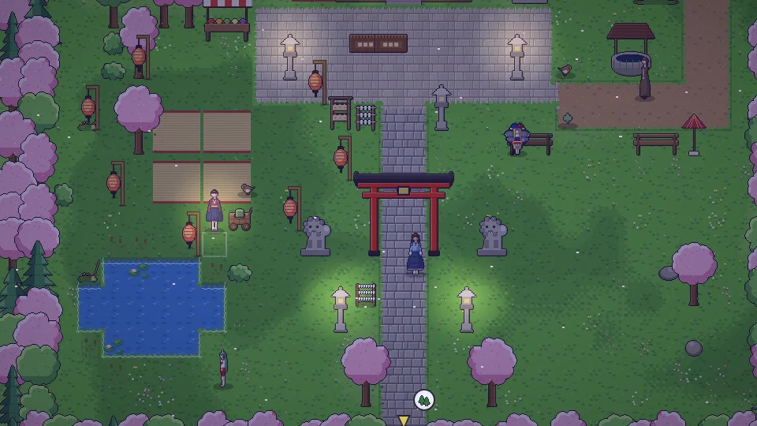
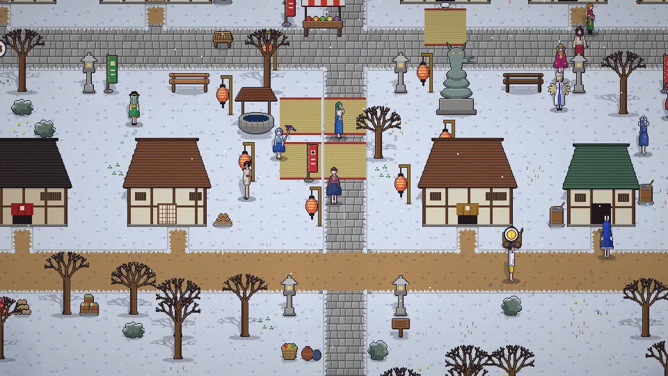
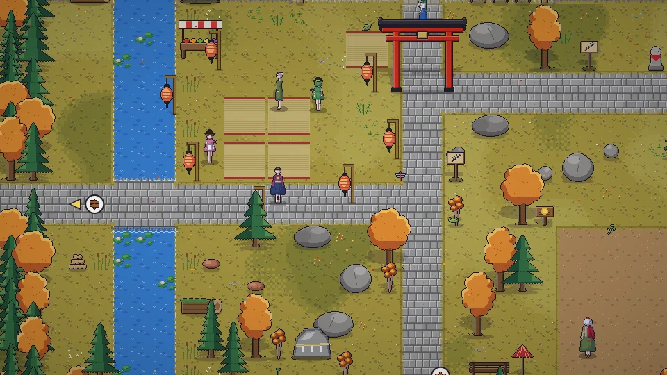
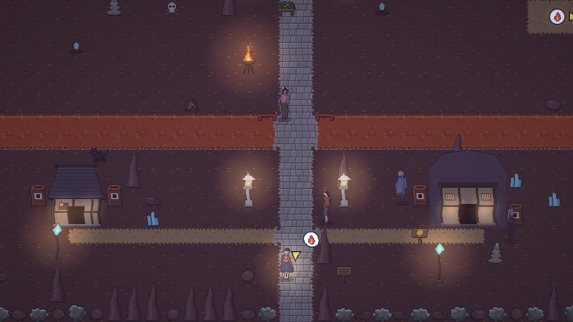

<h1 align="center">동방일일담</h1>

<b>Where the Seasons Rest</b>

<a href="README.md">한국어</a> · <a href="README.ja.md">日本語</a> · <a href="README.zh.md">中文</a> · <b>English</b>

  <a href="https://parkrye.github.io/WebProject_TouhouDays/"><b> Play in your browser</b></a> &nbsp;·&nbsp;
  <a href="https://github.com/parkrye/WebProject_TouhouDays/releases/latest"> Download for offline play</a>

A Touhou Project fan game — a wordless 2D pixel-art life sim Free · No install, runs in the browser · PC & mobile · Saves stay in this browser · Version 0.1.11

## Guides

| | |
|---|---|
|  | **[Controls](docs/en/controls.md)** Keyboard, mouse and touch controls, and what each on-screen button does. |
|  | **[Content](docs/en/content.md)** Days and seasons, farming, crafting, people, the world — what you can do in the game. |

## Screenshots

<table>
<tr><td> Summer festival</td><td> Cherry blossoms at the shrine</td></tr>
<tr><td> Snow festival</td><td> Autumn leaves on Youkai Mountain</td></tr>
<tr><td> The Human Village in spring</td><td> Moon viewing by the lake</td></tr>
<tr><td> Scarlet Devil Mansion library</td><td> The Former Capital underground</td></tr>
</table>

## Bug reports & feedback

Please post in [Discussions](https://github.com/parkrye/WebProject_TouhouDays/discussions). You can also open it with the ladybug button in the in-game settings.

## Version

- 0.1.11
- 0.1.10
- 0.1.9
- 0.1.8
- 0.1.7
- 0.1.6
- 0.1.5
- 0.1.4
- 0.1.3
- 0.1.2
- 0.1.1
- 0.1.0

## Credits

- Original work: 東方Project — 上海アリス幻樂団 (ZUN)
- Font: [Galmuri](https://github.com/quiple/galmuri) — Lee Minseo (SIL Open Font License 1.1)
- Screen effects: pixelfx — Patch, Hugo Duprez (MIT License)
- Git logo: Jason Long (CC BY 3.0)

## License

This game is an unofficial derivative work of the Touhou Project and is distributed for free. Except for third-party components ([THIRD_PARTY_NOTICES.txt](THIRD_PARTY_NOTICES.txt)), copying, modifying, redistributing or selling the game and its assets is not permitted ([LICENSE.txt](LICENSE.txt)).

---

This is a fan-made derivative work of the Touhou Project (Team Shanghai Alice) and is not affiliated with the original creator. Save data lives in this browser (localStorage). Clearing site data deletes it, so use Export in the in-game menu to back it up or move it to another device.
