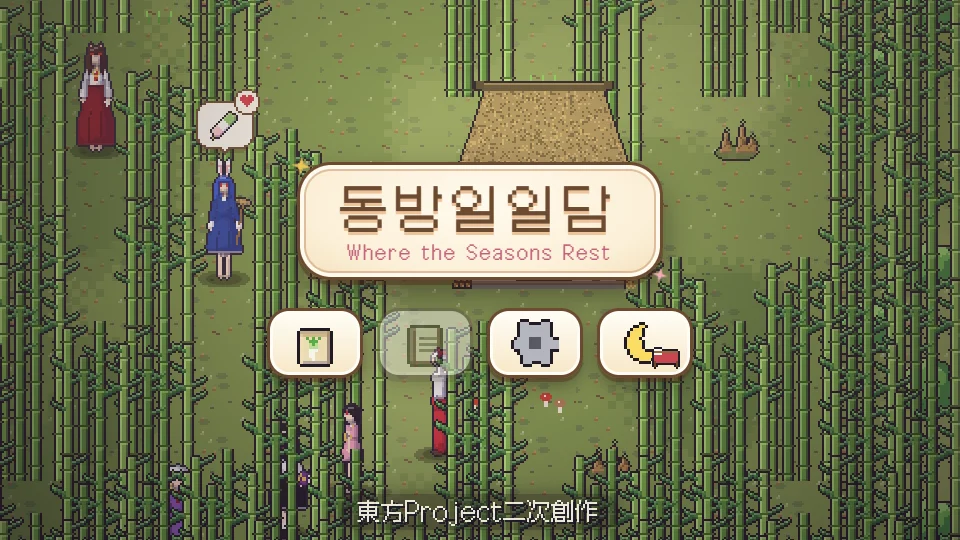
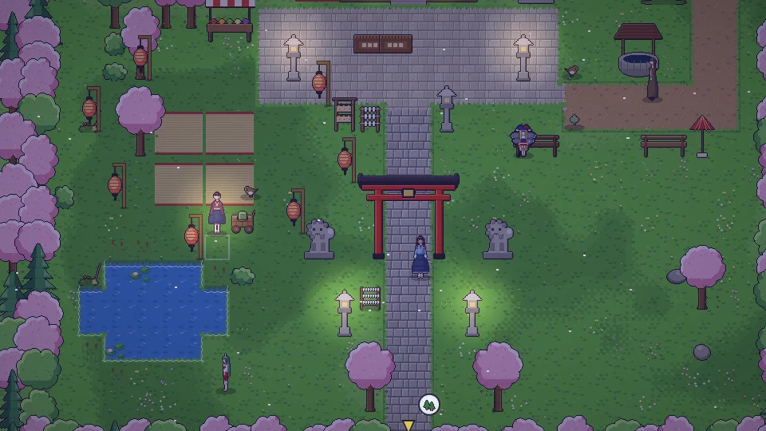
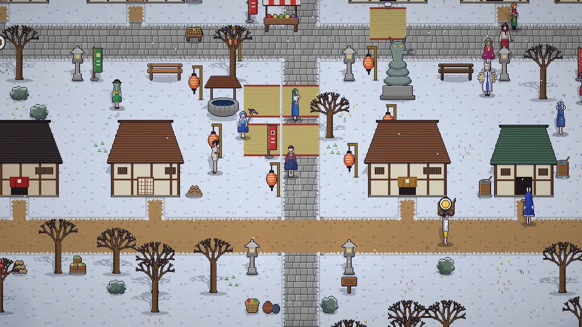
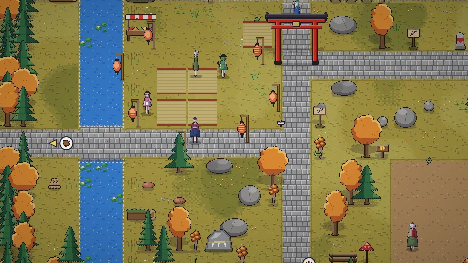
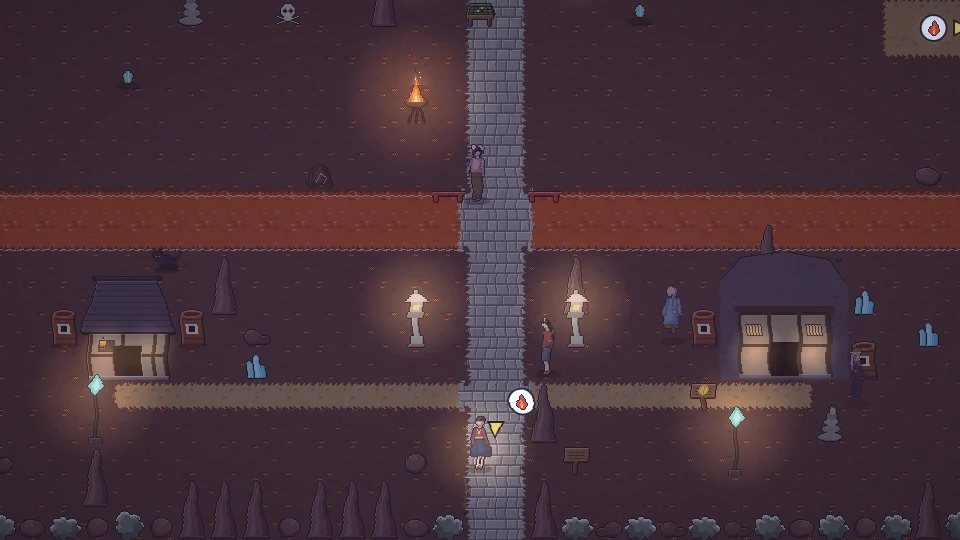

<h1 align="center">동방일일담</h1>

<b>Where the Seasons Rest</b>

<a href="README.md">한국어</a> · <b>日本語</b> · <a href="README.zh.md">中文</a> · <a href="README.en.md">English</a>

  <a href="https://parkrye.github.io/WebProject_TouhouDays/"><b> ブラウザでプレイ</b></a> &nbsp;·&nbsp;
  <a href="https://github.com/parkrye/WebProject_TouhouDays/releases/latest"> オフライン用ダウンロード</a>

東方Project二次創作ファンゲーム — 文字のない2Dドット絵生活シミュレーション 無料 · インストール不要 · PC・スマホ対応 · セーブはこのブラウザに保存 · バージョン 0.1.12

## ガイド

| | |
|---|---|
|  | **[操作方法](docs/ja/controls.md)** キーボード・マウス・タッチ操作と、画面のボタンの役割。 |
|  | **[コンテンツ](docs/ja/content.md)** 一日と季節、農業・ものづくり・人々・世界など、ゲームでできること。 |

## スクリーンショット

<table>
<tr><td> 夏祭り</td><td> 神社のお花見</td></tr>
<tr><td> 雪祭り</td><td> 妖怪の山の紅葉狩り</td></tr>
<tr><td> 春の人間の里</td><td> 湖畔のお月見</td></tr>
<tr><td> 紅魔館の図書館</td><td> 地底の旧都</td></tr>
</table>

## バグ報告・ご意見

[Discussions](https://github.com/parkrye/WebProject_TouhouDays/discussions)にお寄せください。ゲーム内の設定にあるテントウムシのボタンからも開けます。

## バージョン

- 0.1.12
- 0.1.11
- 0.1.10
- 0.1.9
- 0.1.8
- 0.1.7
- 0.1.6
- 0.1.5
- 0.1.4
- 0.1.3
- 0.1.2
- 0.1.1
- 0.1.0

## クレジット

- 原作: 東方Project — 上海アリス幻樂団 (ZUN)
- フォント: [Galmuri](https://github.com/quiple/galmuri) — Lee Minseo (SIL Open Font License 1.1)
- 画面効果: pixelfx — Patch, Hugo Duprez (MIT License)
- Git ロゴ: Jason Long (CC BY 3.0)

## ライセンス

このゲームは東方Projectの非公式二次創作であり、無料で配布しています。第三者のコンポーネント([THIRD_PARTY_NOTICES.txt](THIRD_PARTY_NOTICES.txt))を除き、ゲームおよび素材の複製・改変・再配布・販売は認めていません([LICENSE.txt](LICENSE.txt))。

---

このゲームは東方Project(上海アリス幻樂団)の二次創作ファンゲームであり、原作者とは関係ありません。 セーブデータはこのブラウザ(localStorage)に保存されます。サイトデータを消すと一緒に消えるので、別の端末へ移したり保管したりするときはゲーム内メニューのエクスポートを使ってください。
