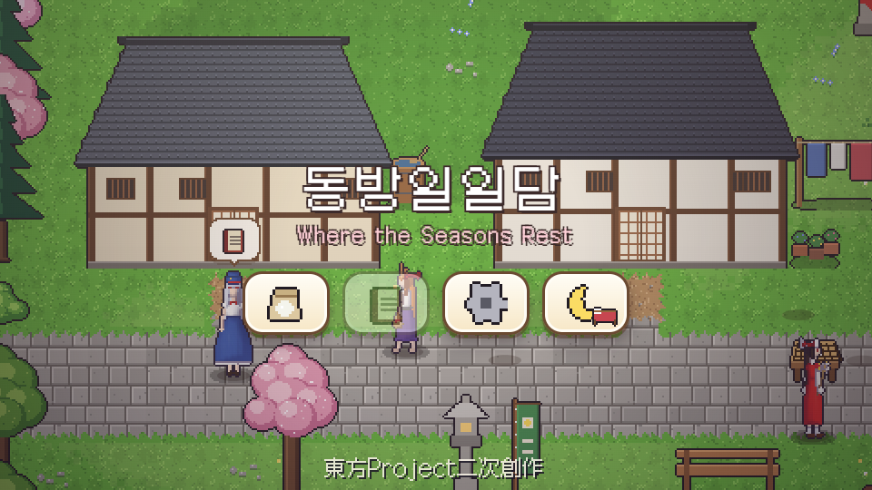
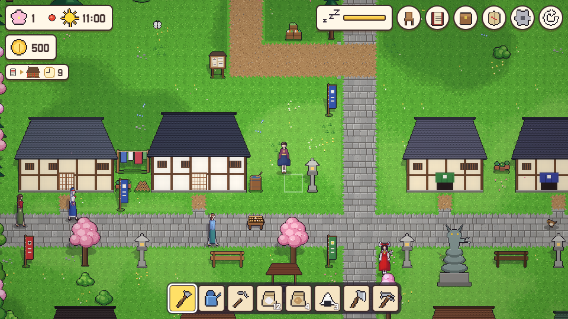
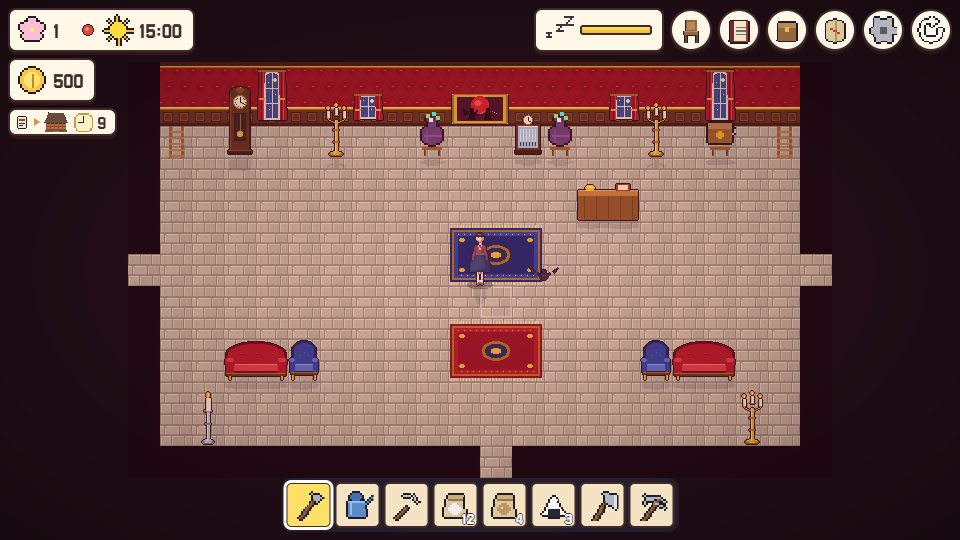
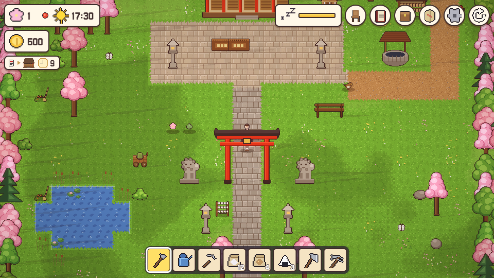
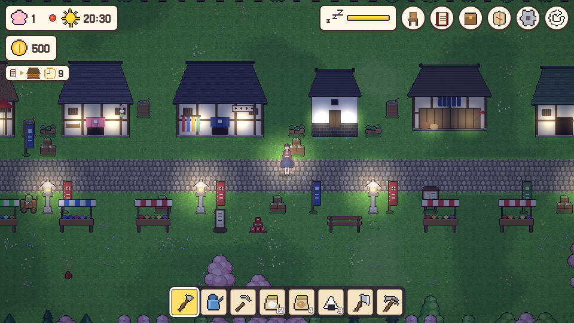

# 동방일일담: Where the Seasons Rest

동방 Project 2차 창작(비공식 팬게임). 글자 없이 그림으로만 즐기는 2D 픽셀 생활 시뮬레이션입니다. PC·모바일 브라우저에서 무료로 플레이할 수 있습니다.

## 플레이

https://parkrye.github.io/WebProject_TouhouDays/

## 조작

| | PC | 모바일 |
|---|---|---|
| 이동 | WASD / 방향키, 먼 곳 클릭 | 화면을 끌기(가상 조이스틱), 먼 곳 탭 |
| 행동 | Space / E, 옆 칸 클릭 | 오른쪽 아래 손 단추, 옆 칸 탭 |
| 도구 고르기 | 1~8, 휠, Q/R | 아래 핫바 탭 |
| 가방 | I / Tab | 가방 단추 |
| 메뉴 | Esc | 톱니 단추 |

## 버그 제보·의견

[Discussions](https://github.com/parkrye/WebProject_TouhouDays/discussions)에 남겨 주세요. 게임 안 설정의 무당벌레 단추로도 열 수 있습니다.

## 버전

- 0.1.7
- 0.1.6
- 0.1.5
- 0.1.4
- 0.1.3
- 0.1.2
- 0.1.1
- 0.1.0

## 크레딧

- 원작: 東方Project — 上海アリス幻樂団 (ZUN)
- 글꼴: [Galmuri](https://github.com/quiple/galmuri) — Lee Minseo (SIL Open Font License 1.1)
- 화면 효과: pixelfx — Patch, Hugo Duprez (MIT License)
- Git 로고: Jason Long (CC BY 3.0)

## 라이선스

이 게임은 東方Project의 비공식 2차 창작물이며 무료로 배포됩니다. 제3자 구성 요소([THIRD_PARTY_NOTICES.txt](THIRD_PARTY_NOTICES.txt))를 제외한 게임과 에셋의 복제·수정·재배포·판매는 허용하지 않습니다([LICENSE.txt](LICENSE.txt)).
