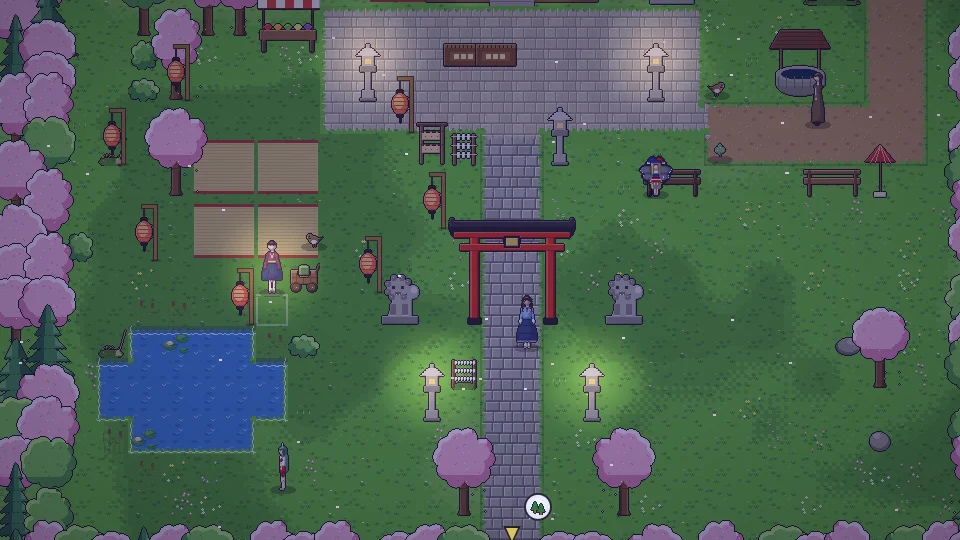
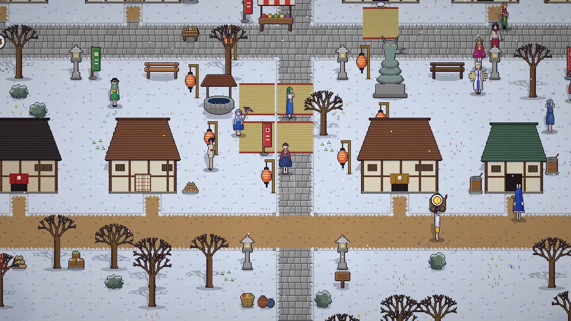
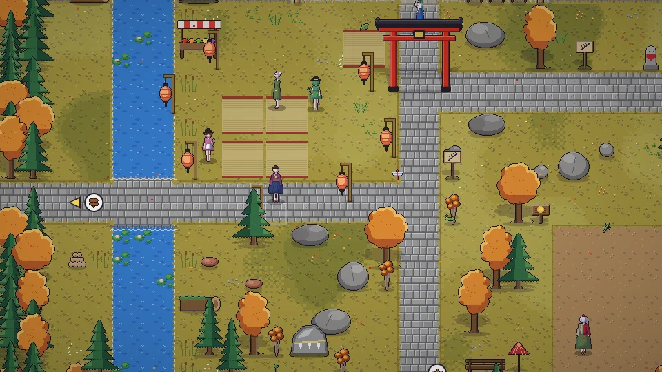
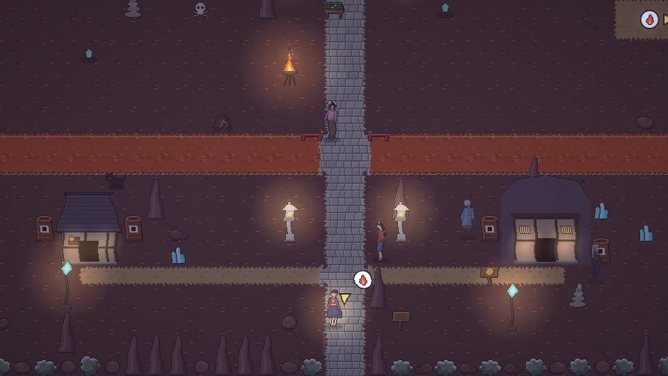

<h1 align="center">동방일일담</h1>

<b>Where the Seasons Rest</b>

<a href="README.md">한국어</a> · <a href="README.ja.md">日本語</a> · <b>中文</b> · <a href="README.en.md">English</a>

  <a href="https://parkrye.github.io/WebProject_TouhouDays/"><b> 在浏览器中游玩</b></a> &nbsp;·&nbsp;
  <a href="https://github.com/parkrye/WebProject_TouhouDays/releases/latest"> 离线版下载</a>

东方Project同人二次创作游戏 — 没有文字的2D像素生活模拟 免费 · 无需安装 · 支持电脑与手机 · 存档保存在本浏览器 · 版本 0.1.11

## 指南

| | |
|---|---|
|  | **[操作说明](docs/zh/controls.md)** 键盘・鼠标・触屏操作，以及画面按钮的作用。 |
|  | **[游戏内容](docs/zh/content.md)** 一天与四季、种田・制作・人物・世界等游戏中可以做的事。 |

## 游戏截图

<table>
<tr><td> 夏日祭</td><td> 神社赏花</td></tr>
<tr><td> 雪祭</td><td> 妖怪之山赏枫</td></tr>
<tr><td> 春日的人类村落</td><td> 湖畔赏月</td></tr>
<tr><td> 红魔馆图书馆</td><td> 地底旧都</td></tr>
</table>

## 错误报告・意见

请在 [Discussions](https://github.com/parkrye/WebProject_TouhouDays/discussions) 留言。也可以通过游戏内设置中的瓢虫按钮打开。

## 版本

- 0.1.11
- 0.1.10
- 0.1.9
- 0.1.8
- 0.1.7
- 0.1.6
- 0.1.5
- 0.1.4
- 0.1.3
- 0.1.2
- 0.1.1
- 0.1.0

## 制作人员

- 原作: 東方Project — 上海アリス幻樂団 (ZUN)
- 字体: [Galmuri](https://github.com/quiple/galmuri) — Lee Minseo (SIL Open Font License 1.1)
- 画面效果: pixelfx — Patch, Hugo Duprez (MIT License)
- Git 标志: Jason Long (CC BY 3.0)

## 许可

本游戏是东方Project的非官方同人二次创作，免费发布。除第三方组件([THIRD_PARTY_NOTICES.txt](THIRD_PARTY_NOTICES.txt))外，不允许复制、修改、再发布或出售本游戏及其素材([LICENSE.txt](LICENSE.txt))。

---

本游戏是东方Project(上海爱丽丝幻乐团)的同人二次创作游戏，与原作者无关。 存档保存在本浏览器(localStorage)中。清除网站数据会一并删除存档;如需转移到其他设备或备份，请使用游戏菜单中的导出功能。
