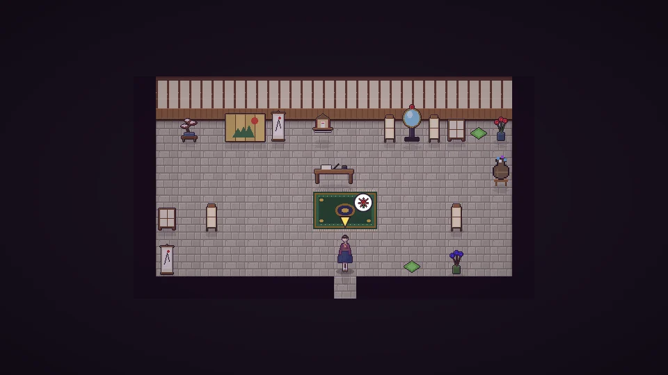

[한국어](../../ko/content/chaos.md) · [日本語](../../ja/content/chaos.md) · [中文](../../zh/content/chaos.md) · **English**

[동방일일담](../../../README.en.md) › [Content](../content.md) › **Breaking things, and the price** &nbsp;10 / 12

#  Breaking things, and the price

You can smash objects and buildings with a hammer. Your own things give back materials, but break someone else’s and you may be seen or heard, rumors spread, and Gensokyo grows unsettled.

Repairing what you broke and doing good deeds slowly sets it right. Visit Eiki Shiki, the Yama, at night to stand trial: her mirror replays your deeds, and finishing your penance clears the rest.

---

[← Festivals](fest.md) &nbsp;·&nbsp; [All topics](../content.md) &nbsp;·&nbsp; [Simulation mode →](sim.md)
