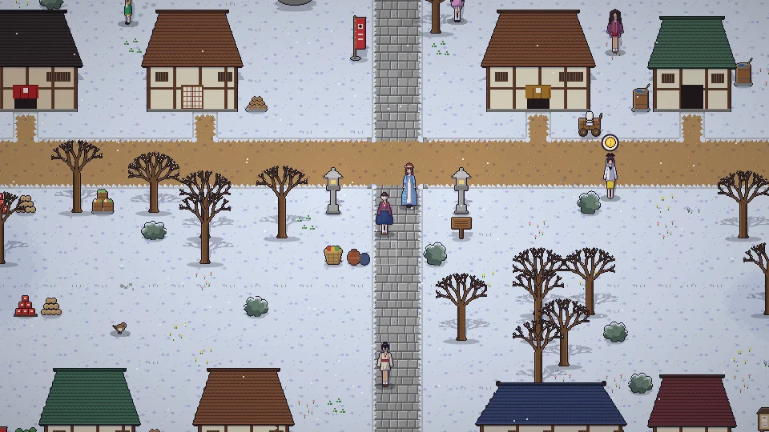

[한국어](../../ko/content/day.md) · [日本語](../../ja/content/day.md) · [中文](../../zh/content/day.md) · **English**

[동방일일담](../../../README.en.md) › [Content](../content.md) › **Days and seasons** &nbsp;2 / 12

#  Days and seasons

Time keeps flowing. Spring, summer, autumn and winter last 28 days each, and the season and weather change which crops grow, which fish bite, what you can forage, and how people spend their day.

Working uses energy. Sleep in your bed to wake up the next morning with energy restored. Push too hard and you’ll collapse.

---

[← Getting started](start.md) &nbsp;·&nbsp; [All topics](../content.md) &nbsp;·&nbsp; [Farming, foraging, fishing →](farm.md)
