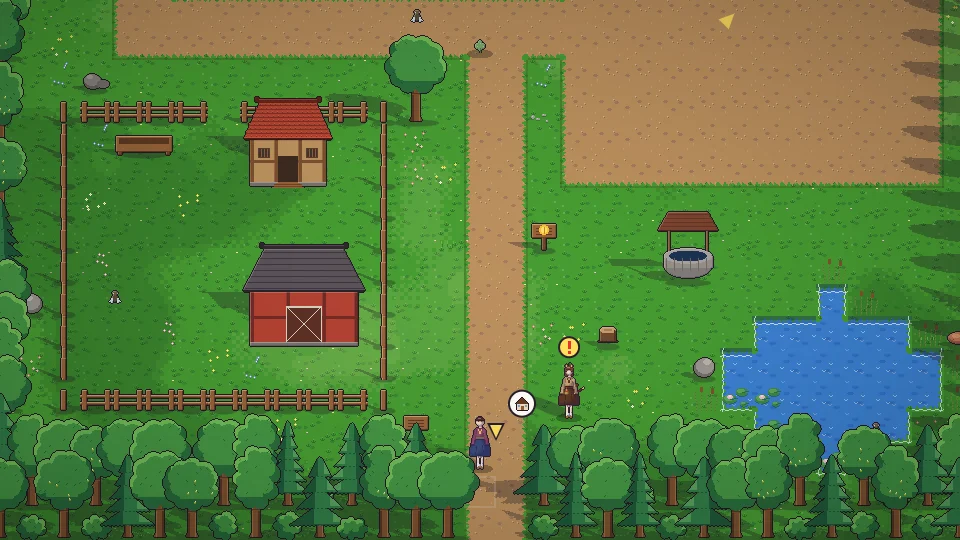

[한국어](../../ko/content/farm.md) · [日本語](../../ja/content/farm.md) · [中文](../../zh/content/farm.md) · **English**

[동방일일담](../../../README.en.md) › [Content](../content.md) › **Farming, foraging, fishing** &nbsp;3 / 12

#  Farming, foraging, fishing

- Till with the hoe, plant seeds and water them with the watering can. How well you care for them sets the harvest quality (★).
- Chop trees with the axe; mine stone and ore with the pickaxe. The mine’s floors change shape every time.
- Hold a fishing rod and act facing water to cast. Wait for the bite, then reel it in.
- Catch bugs with a net, forage plants and fruit in the fields, and tend to animals.

---

[← Days and seasons](day.md) &nbsp;·&nbsp; [All topics](../content.md) &nbsp;·&nbsp; [Processing, crafting, research →](craft.md)
