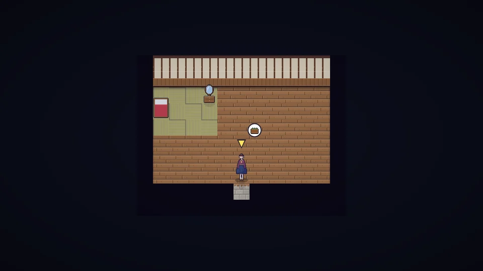

[한국어](../../ko/content/home.md) · [日本語](../../ja/content/home.md) · [中文](../../zh/content/home.md) · **English**

[동방일일담](../../../README.en.md) › [Content](../content.md) › **Home, decorating, clothes** &nbsp;7 / 12

#  Home, decorating, clothes

- Place furniture and decorations. The cozier it is, the higher your home stars (★) — raising max energy and bringing visitors.
- Research lets you extend the house.
- Change your clothes and hairstyle. Clothes wear out the longer you wear them.
- Special parts like horns, wings, ears and tails can’t be picked at the start — they’re earned only through bonds with residents or at festivals.

---

[← Work and money](work.md) &nbsp;·&nbsp; [All topics](../content.md) &nbsp;·&nbsp; [The world →](world.md)
