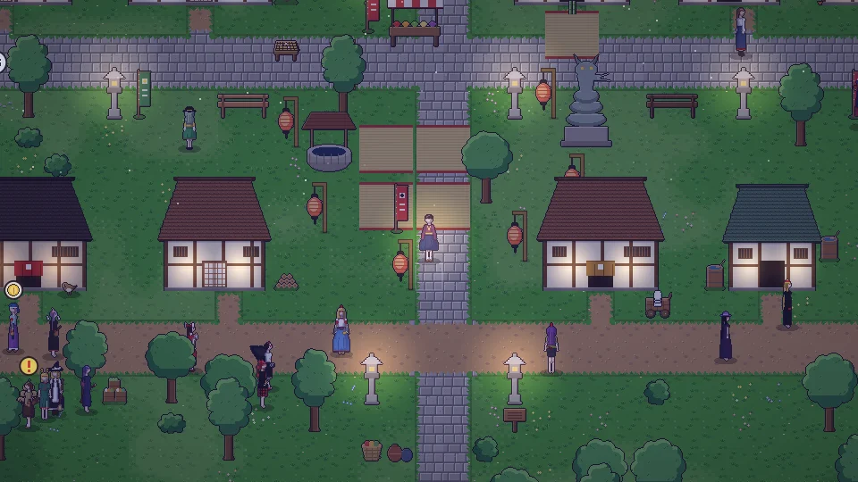

[한국어](../../ko/content/sim.md) · [日本語](../../ja/content/sim.md) · [中文](../../zh/content/sim.md) · **English**

[동방일일담](../../../README.en.md) › [Content](../content.md) › **Simulation mode** &nbsp;11 / 12

#  Simulation mode

Press the last button at the top right and your character lives the day on their own, acting on a hidden personality that slowly shifts with what they do. Press it again any time to take back control.

---

[← Breaking things, and the price](chaos.md) &nbsp;·&nbsp; [All topics](../content.md) &nbsp;·&nbsp; [Saving and photos →](save.md)
