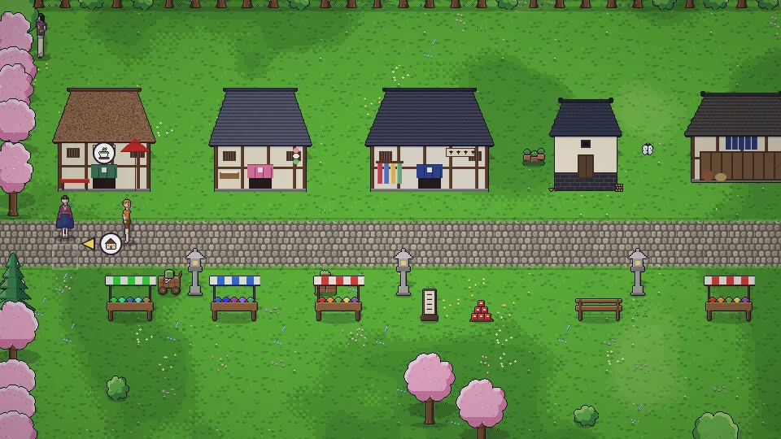

[한국어](../../ko/content/work.md) · [日本語](../../ja/content/work.md) · [中文](../../zh/content/work.md) · **English**

[동방일일담](../../../README.en.md) › [Content](../content.md) › **Work and money** &nbsp;6 / 12

#  Work and money

- Talk to an employer for a part-time job (once a day). It plays as a short minigame; the result shows as ★ and coins.
- Sell what you make and harvest at shops.
- Get a shop of your own to set prices and hire staff. Seasonal demand and reputation shape your sales.
- Make a deal with a contract merchant and they’ll take goods from the delivery box at home and leave the money.

---

[← People](people.md) &nbsp;·&nbsp; [All topics](../content.md) &nbsp;·&nbsp; [Home, decorating, clothes →](home.md)
