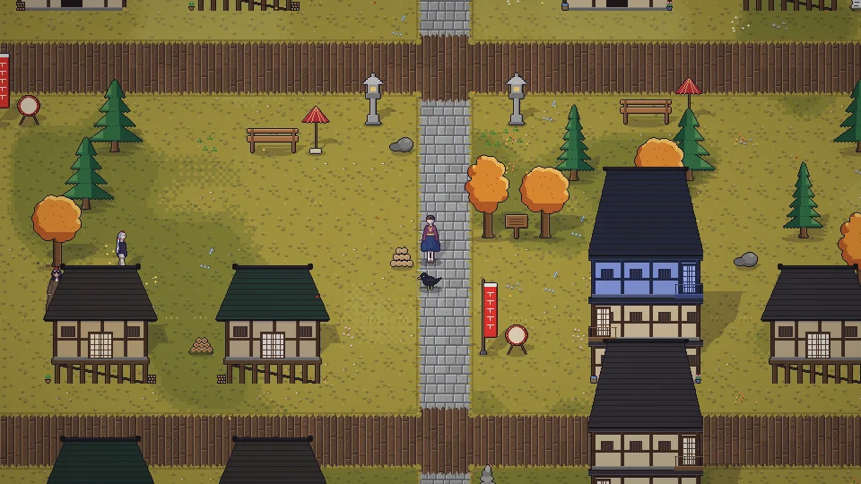

[한국어](../../ko/content/world.md) · [日本語](../../ja/content/world.md) · [中文](../../zh/content/world.md) · **English**

[동방일일담](../../../README.en.md) › [Content](../content.md) › **The world** &nbsp;8 / 12

#  The world

Walk between the Human Village, Hakurei Shrine, Misty Lake, the Scarlet Devil Mansion, the Forest of Magic, the Bamboo Forest of the Lost and Eientei, Youkai Mountain and the Moriya Shrine, Myouren Temple, Genbu Ravine and more. The sky (Netherworld, Heaven) and the underground (Former Capital, Palace of the Earth Spirits and more) are separate layers.

Walk out through the exits at the edges of each map, or tap a known place on the world map (M) to travel there — map travel costs time and energy by distance.

Some places only let you in once you’re close to the people who live there, or if you go with one of them. It’s easy to get lost in the bamboo forest.

---

[← Home, decorating, clothes](home.md) &nbsp;·&nbsp; [All topics](../content.md) &nbsp;·&nbsp; [Festivals →](fest.md)
