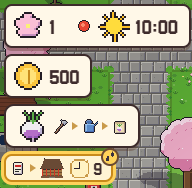
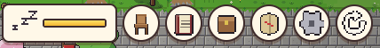
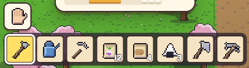

[한국어](../../ko/controls/hud.md) · [日本語](../../ja/controls/hud.md) · [中文](../../zh/controls/hud.md) · **English**

[동방일일담](../../../README.en.md) › [Controls](../controls.md) › **On-screen buttons** &nbsp;4 / 6

#  On-screen buttons

### Top left

1. Season, day, weather, time
2. Money
3. Something to try now (picture card)
4. Appointments / tasks and time left

### Top right

1. Energy bar — drains as you work, refills when you sleep
2. Sit (chair or floor)
3. Research
4. Bag
5. World map
6. Menu
7. Simulation mode on/off

### Bottom

1. Empty-hands button
2. Hotbar, 8 slots — the selected slot is what you hold; numbers are counts

---

[← Touch](touch.md) &nbsp;·&nbsp; [All topics](../controls.md) &nbsp;·&nbsp; [Menu →](menu.md)
