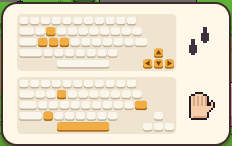

[한국어](../../ko/controls/kb.md) · [日本語](../../ja/controls/kb.md) · [中文](../../zh/controls/kb.md) · **English**

[동방일일담](../../../README.en.md) › [Controls](../controls.md) › **Keyboard** &nbsp;1 / 6

#  Keyboard

| | |
|---|---|
| <kbd>W</kbd> <kbd>A</kbd> <kbd>S</kbd> <kbd>D</kbd> / <kbd>↑</kbd> <kbd>←</kbd> <kbd>↓</kbd> <kbd>→</kbd> | Walk |
| <kbd>Space</kbd> / <kbd>E</kbd> / <kbd>Z</kbd> / <kbd>Enter</kbd> | Act: use what’s in front of you, talk, pick up, open doors |
| <kbd>1</kbd> – <kbd>8</kbd> | Pick a hotbar slot (the tool or item you hold) |
| <kbd>Q</kbd> / <kbd>R</kbd> | Previous / next hotbar slot |
| <kbd>I</kbd> / <kbd>Tab</kbd> / <kbd>X</kbd> | Open your bag |
| <kbd>V</kbd> | Switch to empty hands / switch back |
| <kbd>G</kbd> | Put what you’re holding on the tile in front |
| <kbd>C</kbd> | Sit down on the spot / stand up |
| <kbd>M</kbd> | World map |
| <kbd>Esc</kbd> | Menu, close windows |

> On your first day the same keys are shown on screen as a keyboard picture.

---

[All topics](../controls.md) &nbsp;·&nbsp; [Mouse →](mouse.md)
