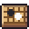

[한국어](../../ko/controls/menu.md) · [日本語](../../ja/controls/menu.md) · [中文](../../zh/controls/menu.md) · **English**

[동방일일담](../../../README.en.md) › [Controls](../controls.md) › **Menu** &nbsp;5 / 6

#  Menu

Menu (Esc / gear button)

| | |
|---|---|
|  | Save now |
|  | Fullscreen |
|  | Save a photo of the room (PNG) |
|  | Save a portrait of yourself (PNG) |
|  | Graphics quality |
|  | Tipsy screen sway on/off |
|  | Board-game lessons |
|  | Save and return to title |
|  | Export save file |
|  | Import save file |
|  | Credits |
|  | Volume (music, sound effects) |

---

[← On-screen buttons](hud.md) &nbsp;·&nbsp; [All topics](../controls.md) &nbsp;·&nbsp; [Good to know →](tips.md)
