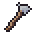

[한국어](../../ko/controls/touch.md) · [日本語](../../ja/controls/touch.md) · [中文](../../zh/controls/touch.md) · **English**

[동방일일담](../../../README.en.md) › [Controls](../controls.md) › **Touch** &nbsp;3 / 6

#  Touch

| | | |
|---|---|---|
|  | **Drag anywhere on screen** | Walk in that direction |
|  | **Hand button, bottom right** | Act on what’s in front of you |
|  | **Tap a hotbar slot** | Pick a tool or item |

- Tapping a person, animal or the ground works like a mouse click.
- Long-press an on-screen button for a picture explanation.
- These three are shown once as picture cards on your first day.

---

[← Mouse](mouse.md) &nbsp;·&nbsp; [All topics](../controls.md) &nbsp;·&nbsp; [On-screen buttons →](hud.md)
