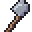
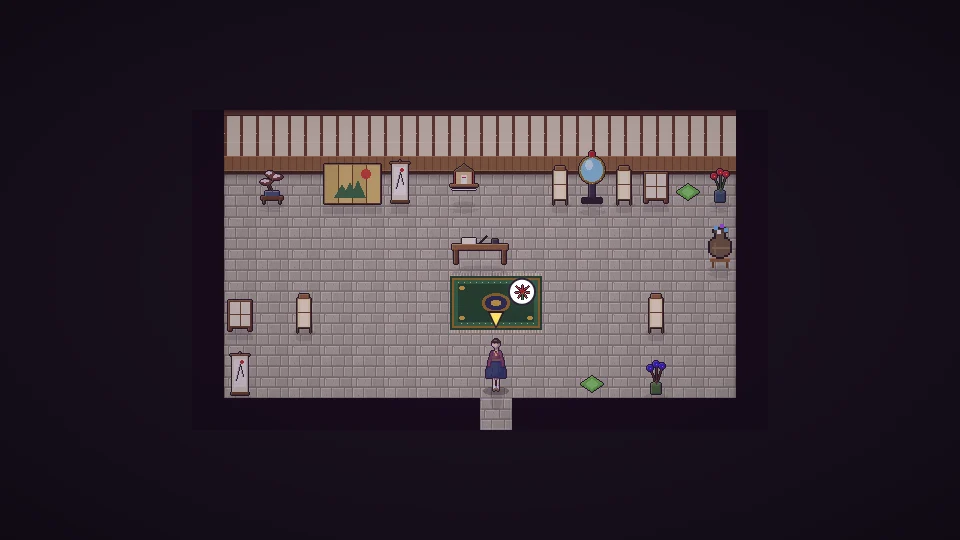

[한국어](../../ko/content/chaos.md) · **日本語** · [中文](../../zh/content/chaos.md) · [English](../../en/content/chaos.md)

[동방일일담](../../../README.ja.md) › [コンテンツ](../content.md) › **壊すことと、その代償** &nbsp;10 / 12

#  壊すことと、その代償

ハンマーで物や建物を壊せます。自分のものなら材料が戻りますが、他人のものを壊すと誰かに見られたり音を聞かれたりして、噂が広まり、幻想郷が乱れていきます。

壊したものを直したり善い行いをしたりすると、少しずつ戻ります。夜に閻魔・四季映姫を訪ねて裁判を受けると、鏡が行いを映し出し、償いを終えれば残りも清められます。

---

[← お祭り](fest.md) &nbsp;·&nbsp; [一覧](../content.md) &nbsp;·&nbsp; [シミュレーションモード →](sim.md)
