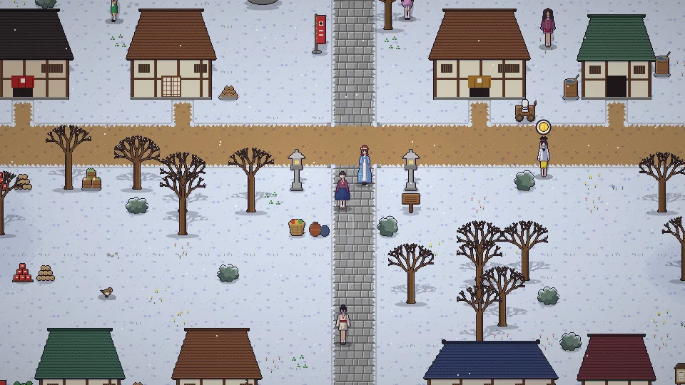

[한국어](../../ko/content/day.md) · **日本語** · [中文](../../zh/content/day.md) · [English](../../en/content/day.md)

[동방일일담](../../../README.ja.md) › [コンテンツ](../content.md) › **一日と季節** &nbsp;2 / 12

#  一日と季節

時間は流れ続けます。春・夏・秋・冬がそれぞれ28日あり、季節と天気によって育つ作物、釣れる魚、拾えるもの、人々の一日が変わります。

働くと元気が減ります。ベッドで眠ると翌朝になり、元気が回復します。無理をしすぎると倒れるので気をつけて。

---

[← はじめに](start.md) &nbsp;·&nbsp; [一覧](../content.md) &nbsp;·&nbsp; [農業・採集・釣り →](farm.md)
