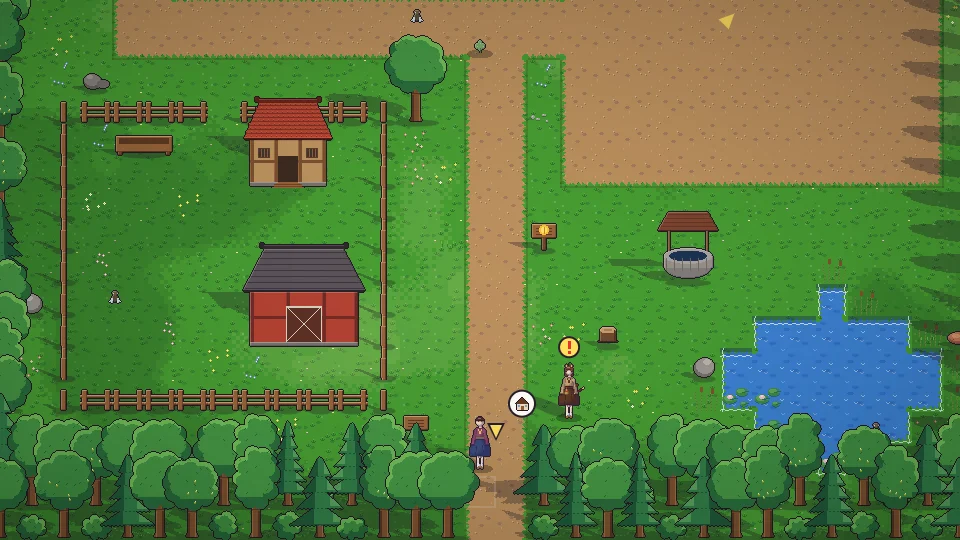

[한국어](../../ko/content/farm.md) · **日本語** · [中文](../../zh/content/farm.md) · [English](../../en/content/farm.md)

[동방일일담](../../../README.ja.md) › [コンテンツ](../content.md) › **農業・採集・釣り** &nbsp;3 / 12

#  農業・採集・釣り

- クワで畑を耕し、種をまき、じょうろで水をやります。どれだけ手をかけたかが収穫物の品質(★)になります。
- 斧で木を、つるはしで石や鉱石を手に入れます。鉱山は階ごとに形が変わります。
- 釣り竿を持って水の前でアクションすると釣りが始まります。アタリが来たら待って釣り上げます。
- 虫取り網で虫を捕まえ、野原の草や実を拾い、動物の世話をします。

---

[← 一日と季節](day.md) &nbsp;·&nbsp; [一覧](../content.md) &nbsp;·&nbsp; [加工・ものづくり・研究 →](craft.md)
