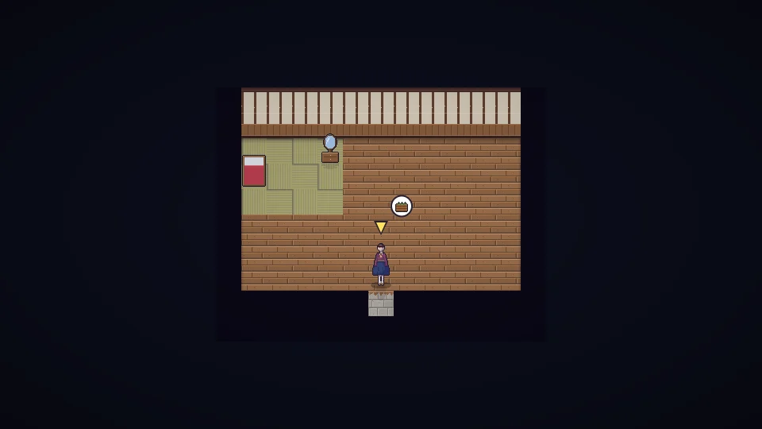

[한국어](../../ko/content/home.md) · **日本語** · [中文](../../zh/content/home.md) · [English](../../en/content/home.md)

[동방일일담](../../../README.ja.md) › [コンテンツ](../content.md) › **家・模様替え・服** &nbsp;7 / 12

#  家・模様替え・服

- 家具や飾りを置いて家を飾ります。居心地がいいほど家の星(★)が上がり、最大元気が増え、お客さんが訪ねてきます。
- 研究で家を広げられます。
- 服や髪型を変えられます。服は長く着ると古びていきます。
- 角・翼・耳・しっぽのような特別な飾りは最初からは選べず、住人との絆やお祭りでのみ手に入ります。

---

[← 仕事とお金](work.md) &nbsp;·&nbsp; [一覧](../content.md) &nbsp;·&nbsp; [世界 →](world.md)
