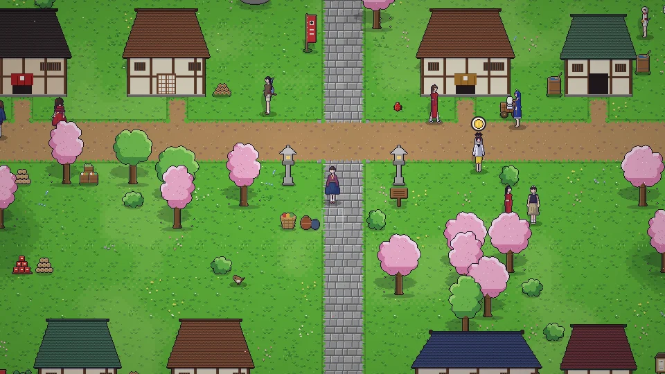

[한국어](../../ko/content/people.md) · **日本語** · [中文](../../zh/content/people.md) · [English](../../en/content/people.md)

[동방일일담](../../../README.ja.md) › [コンテンツ](../content.md) › **人々** &nbsp;5 / 12

#  人々

- 幻想郷の人々は、それぞれの予定や気分、記憶を持って一日を過ごしています。アクションキーやタップで話しかけたり、贈り物をしたりできます。
- 仲良くなる(ハート)と特別な場面が見られ、一緒に歩いてもらったり、約束や招待をやり取りしたりできます。約束の場所は地図に表示されます。
- 椅子やベンチに一緒に座ったり、道端で一杯やっていると、お酒好きな人が寄ってくることも。新聞広告で宴会を開くこともできます。
- ボードゲームの盤を持って話しかけると対局を申し込めます：将棋・チェス・五目並べ・リバーシ・おはじき。ルールはメニューの「ボードゲームを学ぶ」で覚えられます。

---

[← 加工・ものづくり・研究](craft.md) &nbsp;·&nbsp; [一覧](../content.md) &nbsp;·&nbsp; [仕事とお金 →](work.md)
