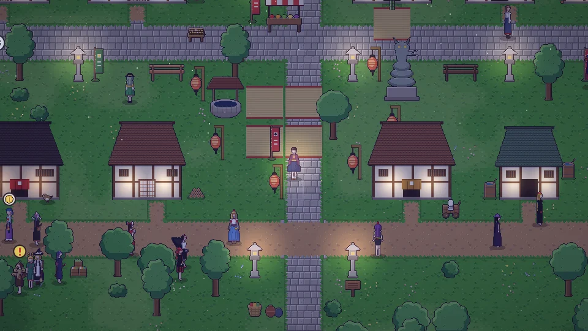

[한국어](../../ko/content/sim.md) · **日本語** · [中文](../../zh/content/sim.md) · [English](../../en/content/sim.md)

[동방일일담](../../../README.ja.md) › [コンテンツ](../content.md) › **シミュレーションモード** &nbsp;11 / 12

#  シミュレーションモード

右上の最後のボタンを押すと、自分のキャラクターが自分で一日を過ごします。隠れた性格に従って行動し、した行動によって性格も少しずつ変わります。もう一度押せば、いつでも自分の操作に戻れます。

---

[← 壊すことと、その代償](chaos.md) &nbsp;·&nbsp; [一覧](../content.md) &nbsp;·&nbsp; [セーブと写真 →](save.md)
