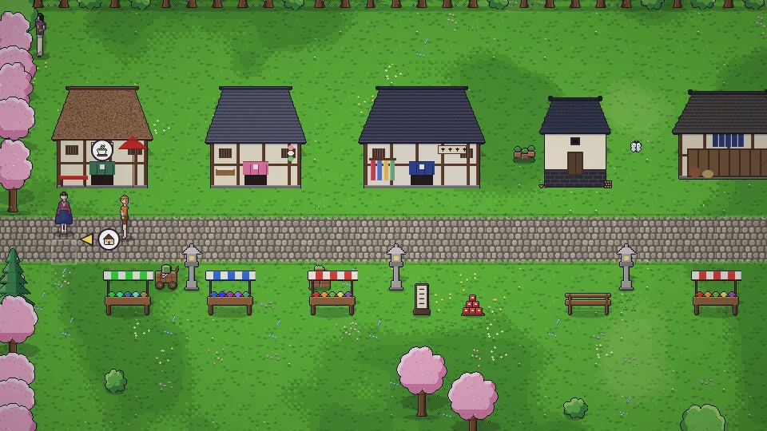

[한국어](../../ko/content/work.md) · **日本語** · [中文](../../zh/content/work.md) · [English](../../en/content/work.md)

[동방일일담](../../../README.ja.md) › [コンテンツ](../content.md) › **仕事とお金** &nbsp;6 / 12

#  仕事とお金

- 雇い主に話しかけるとアルバイトができます(1日1回)。短いミニゲームで進み、結果は★と硬貨で表されます。
- 作ったものや収穫したものはお店に売れます。
- 自分の店を持てば、値段を決め、店員を雇って商売ができます。季節ごとの需要と評判が売り上げを左右します。
- 契約商人と約束を結ぶと、家の納品箱から品物を持っていき、代金を置いていきます。

---

[← 人々](people.md) &nbsp;·&nbsp; [一覧](../content.md) &nbsp;·&nbsp; [家・模様替え・服 →](home.md)
