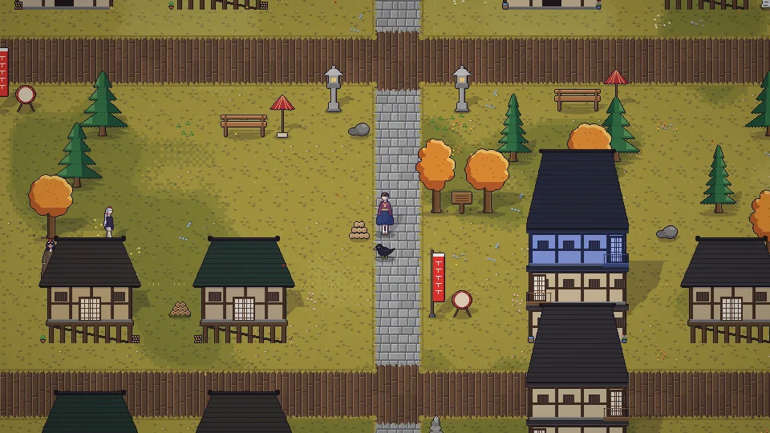

[한국어](../../ko/content/world.md) · **日本語** · [中文](../../zh/content/world.md) · [English](../../en/content/world.md)

[동방일일담](../../../README.ja.md) › [コンテンツ](../content.md) › **世界** &nbsp;8 / 12

#  世界

人間の里、博麗神社、霧の湖、紅魔館、魔法の森、迷いの竹林と永遠亭、妖怪の山と守矢神社、命蓮寺、玄武の沢などを歩いて行き来します。空(冥界・天界)と地下(旧都・地霊殿など)は別の層です。

マップの端の出口から歩いて行くか、世界地図(M)で知っている場所を押して移動します。地図で移動すると、距離に応じて時間と元気を使います。

場所によっては、そこの住人と仲良くなるか、一緒に行かないと入れません。竹林では道に迷いやすいです。

---

[← 家・模様替え・服](home.md) &nbsp;·&nbsp; [一覧](../content.md) &nbsp;·&nbsp; [お祭り →](fest.md)
