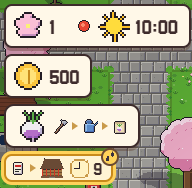
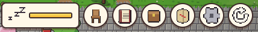
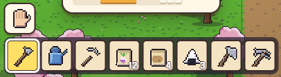

[한국어](../../ko/controls/hud.md) · **日本語** · [中文](../../zh/controls/hud.md) · [English](../../en/controls/hud.md)

[동방일일담](../../../README.ja.md) › [操作方法](../controls.md) › **画面のボタン** &nbsp;4 / 6

#  画面のボタン

### 左上

1. 季節・日付・天気・時刻
2. 所持金
3. 今やってみること(絵のカード)
4. 約束・用事と残り時間

### 右上

1. 元気ゲージ — 働くほど減り、眠ると回復
2. 座る(椅子・床)
3. 研究
4. かばん
5. 世界地図
6. メニュー
7. シミュレーションモードのオン/オフ

### 下

1. 素手ボタン
2. ホットバー8枠 — 選んだ枠が手に持っているもの。数字は残りの個数

---

[← タッチ](touch.md) &nbsp;·&nbsp; [一覧](../controls.md) &nbsp;·&nbsp; [メニュー →](menu.md)
