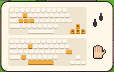

[한국어](../../ko/controls/kb.md) · **日本語** · [中文](../../zh/controls/kb.md) · [English](../../en/controls/kb.md)

[동방일일담](../../../README.ja.md) › [操作方法](../controls.md) › **キーボード** &nbsp;1 / 6

#  キーボード

| | |
|---|---|
| <kbd>W</kbd> <kbd>A</kbd> <kbd>S</kbd> <kbd>D</kbd> / <kbd>↑</kbd> <kbd>←</kbd> <kbd>↓</kbd> <kbd>→</kbd> | 歩く |
| <kbd>Space</kbd> / <kbd>E</kbd> / <kbd>Z</kbd> / <kbd>Enter</kbd> | アクション：目の前のものを使う・話しかける・拾う・扉を開ける |
| <kbd>1</kbd> – <kbd>8</kbd> | ホットバーの枠を選ぶ(持つ道具・アイテム) |
| <kbd>Q</kbd> / <kbd>R</kbd> | ホットバーの前の枠/次の枠 |
| <kbd>I</kbd> / <kbd>Tab</kbd> / <kbd>X</kbd> | かばんを開く |
| <kbd>V</kbd> | 素手に切り替え/戻す |
| <kbd>G</kbd> | 持っているものを前のマスに置く |
| <kbd>C</kbd> | その場に座る/立つ |
| <kbd>M</kbd> | 世界地図 |
| <kbd>Esc</kbd> | メニュー・ウィンドウを閉じる |

> ゲーム初日の画面にも、同じ内容がキーボードの絵で表示されます。

---

[一覧](../controls.md) &nbsp;·&nbsp; [マウス →](mouse.md)
