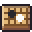

[한국어](../../ko/controls/menu.md) · **日本語** · [中文](../../zh/controls/menu.md) · [English](../../en/controls/menu.md)

[동방일일담](../../../README.ja.md) › [操作方法](../controls.md) › **メニュー** &nbsp;5 / 6

#  メニュー

メニュー(Esc・歯車ボタン)

| | |
|---|---|
|  | 今すぐセーブ |
|  | 全画面 |
|  | 部屋の写真を保存(PNG) |
|  | 自分の姿の写真を保存(PNG) |
|  | グラフィック品質 |
|  | 酔ったときの画面の揺れ オン/オフ |
|  | ボードゲームを学ぶ |
|  | セーブしてタイトルへ |
|  | セーブファイルを書き出す |
|  | セーブファイルを読み込む |
|  | クレジット |
|  | 音量(BGM・効果音) |

---

[← 画面のボタン](hud.md) &nbsp;·&nbsp; [一覧](../controls.md) &nbsp;·&nbsp; [覚えておくと便利 →](tips.md)
