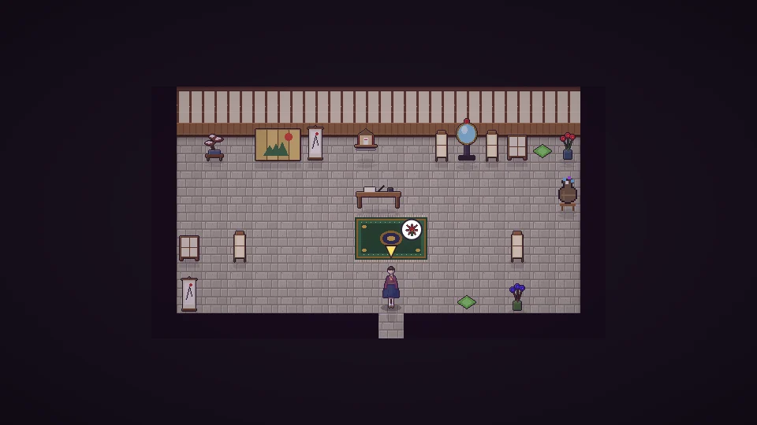

**한국어** · [日本語](../../ja/content/chaos.md) · [中文](../../zh/content/chaos.md) · [English](../../en/content/chaos.md)

[동방일일담](../../../README.md) › [콘텐츠](../content.md) › **부수기와 대가** &nbsp;10 / 12

#  부수기와 대가

망치로 물건이나 건물을 부술 수 있습니다. 내 것은 재료가 돌아오지만, 남의 것을 부수면 누군가 보거나 소리를 듣고, 소문이 퍼지고, 환상향이 어지러워집니다.

부순 것을 고치거나 착한 일을 하면 조금씩 회복됩니다. 밤에 염마 시키 에이키를 찾아가 재판을 받으면 거울이 지은 일을 비추고, 속죄할 일을 마치면 나머지도 씻을 수 있습니다.

---

[← 축제](fest.md) &nbsp;·&nbsp; [목록](../content.md) &nbsp;·&nbsp; [시뮬레이션 모드 →](sim.md)
