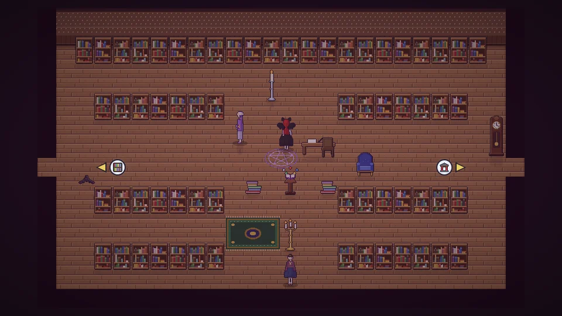

**한국어** · [日本語](../../ja/content/craft.md) · [中文](../../zh/content/craft.md) · [English](../../en/content/craft.md)

[동방일일담](../../../README.md) › [콘텐츠](../content.md) › **가공 · 제작 · 연구** &nbsp;4 / 12

#  가공 · 제작 · 연구

- 원재료 → 가공 → 부품 → 완성품의 여러 단계로 물건을 만듭니다. 예: 대나무를 베어 말리고, 쪼개서 바구니를 엮습니다.
- 작업대에서 각종 작업 도구를 만들어 놓고 씁니다. 시간이 걸리는 작업은 맡겨 두고 다른 일을 하다 와도 됩니다.
- 연구(책 단추)는 그 분야의 스승이 되는 주민과 같은 곳에 있을 때 시작할 수 있고, 다음 날 아침 끝납니다. 새 제작법, 가방 칸, 도구 강화, 집 증축 등이 열립니다.
- 요리는 재료의 맛이 그대로 요리로 이어집니다.

---

[← 농사 · 채집 · 낚시](farm.md) &nbsp;·&nbsp; [목록](../content.md) &nbsp;·&nbsp; [사람들 →](people.md)
