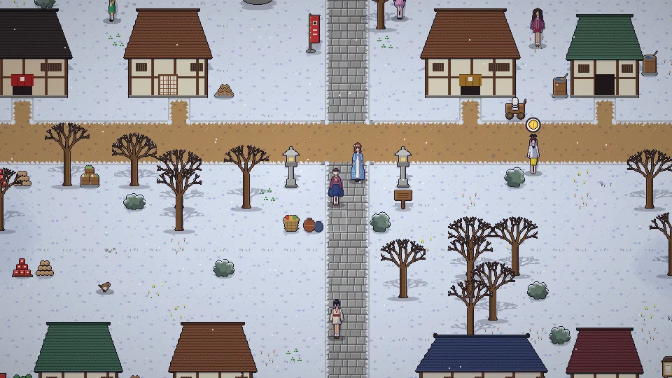

**한국어** · [日本語](../../ja/content/day.md) · [中文](../../zh/content/day.md) · [English](../../en/content/day.md)

[동방일일담](../../../README.md) › [콘텐츠](../content.md) › **하루와 계절** &nbsp;2 / 12

#  하루와 계절

시간은 계속 흐릅니다. 봄·여름·가을·겨울이 각 28일이고, 계절과 날씨에 따라 자라는 작물, 잡히는 물고기, 주울 수 있는 것, 사람들의 하루가 달라집니다.

일을 하면 기운이 줄어듭니다. 침대에서 자면 다음 날 아침이 되고 기운이 찹니다. 너무 무리하면 쓰러지니 조심하세요.

---

[← 시작하기](start.md) &nbsp;·&nbsp; [목록](../content.md) &nbsp;·&nbsp; [농사 · 채집 · 낚시 →](farm.md)
