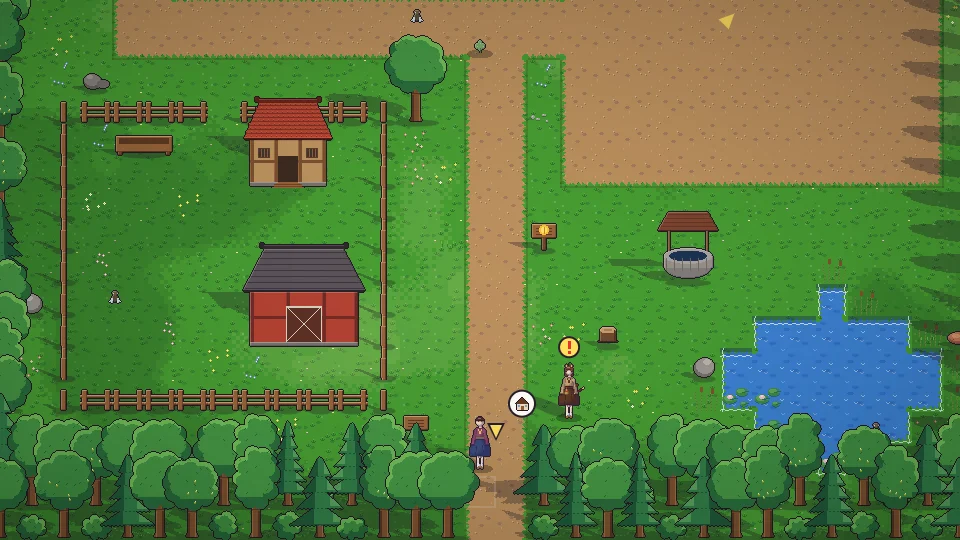

**한국어** · [日本語](../../ja/content/farm.md) · [中文](../../zh/content/farm.md) · [English](../../en/content/farm.md)

[동방일일담](../../../README.md) › [콘텐츠](../content.md) › **농사 · 채집 · 낚시** &nbsp;3 / 12

#  농사 · 채집 · 낚시

- 괭이로 밭을 갈고 씨앗을 심고 물뿌리개로 물을 줍니다. 얼마나 잘 돌봤는지가 수확물의 품질(★)이 됩니다.
- 도끼로 나무를, 곡괭이로 돌과 광석을 얻습니다. 광산은 층마다 모양이 새로 바뀝니다.
- 낚싯대를 들고 물 앞에서 행동하면 낚시를 시작합니다. 입질이 오면 기다렸다가 낚아 올립니다.
- 잠자리채로 벌레를 잡고, 들판의 풀과 열매를 줍고, 동물을 돌봅니다.

---

[← 하루와 계절](day.md) &nbsp;·&nbsp; [목록](../content.md) &nbsp;·&nbsp; [가공 · 제작 · 연구 →](craft.md)
