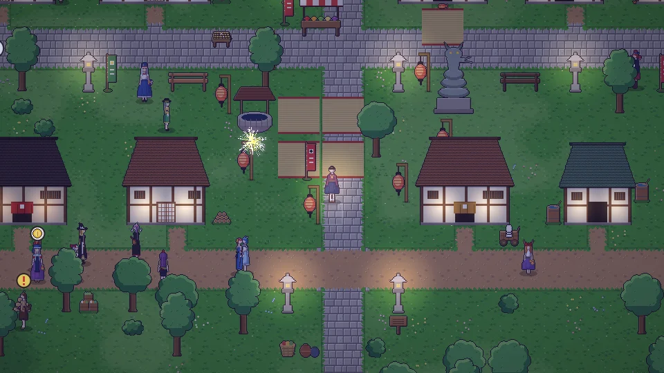

**한국어** · [日本語](../../ja/content/fest.md) · [中文](../../zh/content/fest.md) · [English](../../en/content/fest.md)

[동방일일담](../../../README.md) › [콘텐츠](../content.md) › **축제** &nbsp;9 / 12

#  축제

정해진 날이면 마을이나 신사 등에서 축제가 열립니다. 노점에서 먹고, 놀이 자리에서 미니게임을 하고, 밤하늘 볼거리를 구경합니다.

하쓰모데 · 세쓰분 · 꽃놀이 · 칠석 · 여름 축제 · 오봉 · 달맞이 · 단풍 구경 · 지저 온천 축제 · 눈 축제.

---

[← 세계](world.md) &nbsp;·&nbsp; [목록](../content.md) &nbsp;·&nbsp; [부수기와 대가 →](chaos.md)
