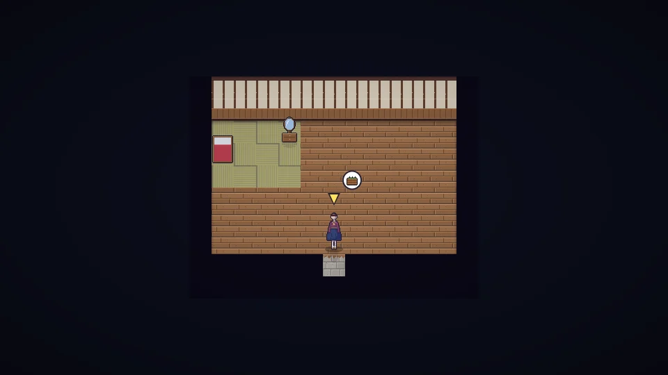

**한국어** · [日本語](../../ja/content/home.md) · [中文](../../zh/content/home.md) · [English](../../en/content/home.md)

[동방일일담](../../../README.md) › [콘텐츠](../content.md) › **집 · 꾸미기 · 옷** &nbsp;7 / 12

#  집 · 꾸미기 · 옷

- 가구와 장식을 놓아 집을 꾸밉니다. 편안할수록 집 별(★)이 오르고, 최대 기운이 늘고, 손님이 찾아옵니다.
- 연구로 집을 넓힐 수 있습니다.
- 옷과 머리 모양을 바꿀 수 있습니다. 옷은 오래 입으면 낡습니다.
- 뿔·날개·귀·꼬리 같은 특별한 꾸밈은 처음부터 고를 수 없고, 주민과의 인연이나 축제에서만 얻습니다.

---

[← 일과 돈](work.md) &nbsp;·&nbsp; [목록](../content.md) &nbsp;·&nbsp; [세계 →](world.md)
