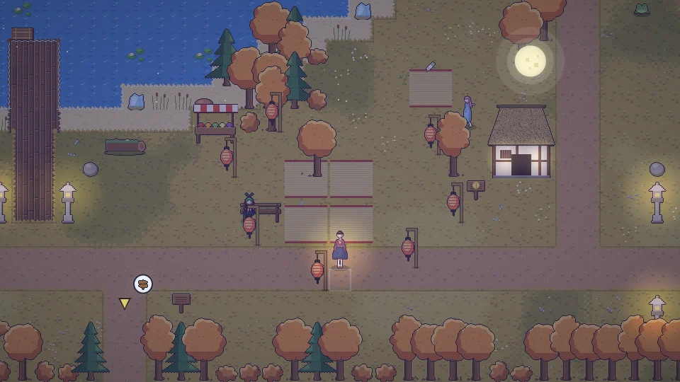

**한국어** · [日本語](../../ja/content/save.md) · [中文](../../zh/content/save.md) · [English](../../en/content/save.md)

[동방일일담](../../../README.md) › [콘텐츠](../content.md) › **저장과 사진** &nbsp;12 / 12

#  저장과 사진

날이 바뀔 때 자동 저장되며, 메뉴에서 직접 저장할 수도 있습니다. 저장은 브라우저에 남으므로 다른 기기로 옮기려면 내보내기/가져오기를 쓰세요.

메뉴에서 방 사진이나 내 모습 사진을 PNG로 저장할 수 있습니다.

---

[← 시뮬레이션 모드](sim.md) &nbsp;·&nbsp; [목록](../content.md)
