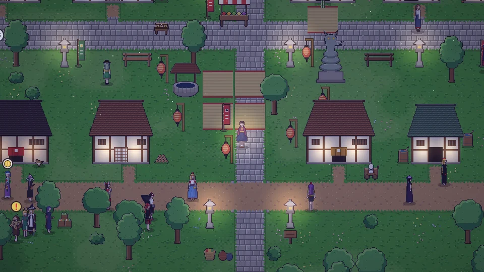

**한국어** · [日本語](../../ja/content/sim.md) · [中文](../../zh/content/sim.md) · [English](../../en/content/sim.md)

[동방일일담](../../../README.md) › [콘텐츠](../content.md) › **시뮬레이션 모드** &nbsp;11 / 12

#  시뮬레이션 모드

오른쪽 위 마지막 단추를 누르면 내 캐릭터가 스스로 하루를 삽니다. 숨은 성향을 따라 행동하고, 한 일에 따라 성향도 조금씩 바뀝니다. 언제든 다시 눌러 직접 조작으로 돌아올 수 있습니다.

---

[← 부수기와 대가](chaos.md) &nbsp;·&nbsp; [목록](../content.md) &nbsp;·&nbsp; [저장과 사진 →](save.md)
