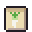

**한국어** · [日本語](../../ja/content/start.md) · [中文](../../zh/content/start.md) · [English](../../en/content/start.md)

[동방일일담](../../../README.md) › [콘텐츠](../content.md) › **시작하기** &nbsp;1 / 12

#  시작하기

타이틀의 그림 단추 넷: 새싹 = 새로 시작, 책 = 이어 하기, 톱니 = 설정, 달과 이불 = 끄기.

새로 시작하면 짧은 오프닝 뒤 내 모습을 꾸미고 첫 아침을 맞습니다. 첫날에는 해 볼 일이 그림 카드로, 가야 할 곳이 발자국으로 안내됩니다.

게임 안에는 글자가 없습니다. 대화·안내·메뉴는 그림, 표정 말풍선, 몸짓, 숫자로 이루어집니다.

---

[목록](../content.md) &nbsp;·&nbsp; [하루와 계절 →](day.md)
