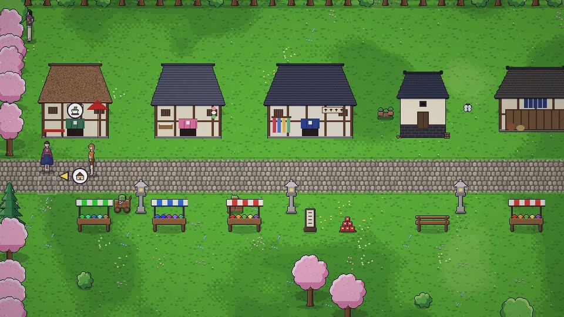

**한국어** · [日本語](../../ja/content/work.md) · [中文](../../zh/content/work.md) · [English](../../en/content/work.md)

[동방일일담](../../../README.md) › [콘텐츠](../content.md) › **일과 돈** &nbsp;6 / 12

#  일과 돈

- 고용주에게 말을 걸면 아르바이트를 할 수 있습니다(하루 한 번). 짧은 미니게임으로 진행되고 결과는 ★과 동전으로 나옵니다.
- 만든 것과 거둔 것은 가게에 팔 수 있습니다.
- 내 가게를 얻으면 값을 정하고 직원을 두어 장사를 할 수 있습니다. 계절에 따른 수요와 평판이 매출을 좌우합니다.
- 계약 상인과 약속을 맺으면 집의 납품 상자에서 물건을 가져가고 돈을 두고 갑니다.

---

[← 사람들](people.md) &nbsp;·&nbsp; [목록](../content.md) &nbsp;·&nbsp; [집 · 꾸미기 · 옷 →](home.md)
