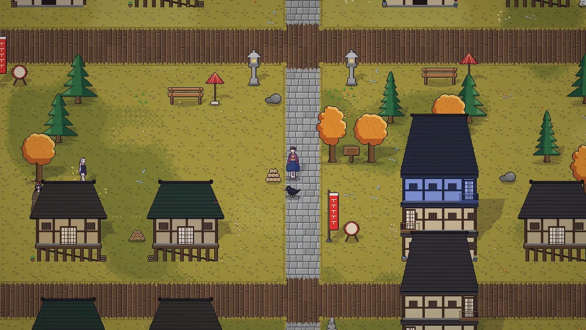

**한국어** · [日本語](../../ja/content/world.md) · [中文](../../zh/content/world.md) · [English](../../en/content/world.md)

[동방일일담](../../../README.md) › [콘텐츠](../content.md) › **세계** &nbsp;8 / 12

#  세계

인간 마을, 하쿠레이 신사, 안개 호수, 홍마관, 마법의 숲, 미궁 대나무숲과 영원정, 요괴의 산과 모리야 신사, 명련사, 현무의 계곡 등을 걸어서 오갑니다. 하늘(명계 · 천계)과 땅 밑(구도 · 지령전 등)은 다른 층입니다.

맵 가장자리 출구로 걸어서 가거나, 세계 지도(M)에서 아는 곳을 눌러 이동합니다. 지도로 가면 거리만큼 시간과 기운이 듭니다.

어떤 곳은 그곳 주민과 친해지거나 함께 가야 들어갈 수 있습니다. 대나무숲에서는 길을 잃기 쉽습니다.

---

[← 집 · 꾸미기 · 옷](home.md) &nbsp;·&nbsp; [목록](../content.md) &nbsp;·&nbsp; [축제 →](fest.md)
