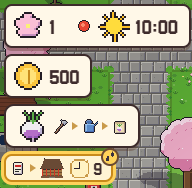
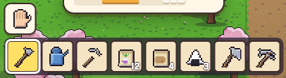

**한국어** · [日本語](../../ja/controls/hud.md) · [中文](../../zh/controls/hud.md) · [English](../../en/controls/hud.md)

[동방일일담](../../../README.md) › [조작법](../controls.md) › **화면 단추** &nbsp;4 / 6

#  화면 단추

### 왼쪽 위

1. 계절 · 날짜 · 날씨 · 시각
2. 가진 돈
3. 지금 해 볼 일 (그림 카드)
4. 약속 · 할 일과 남은 시간

### 오른쪽 위

1. 기운 막대 — 일할수록 줄고, 자면 찹니다
2. 앉기 (의자·바닥)
3. 연구
4. 가방
5. 세계 지도
6. 메뉴
7. 시뮬레이션 모드 켜기/끄기

### 아래

1. 빈손 단추
2. 핫바 8칸 — 고른 칸이 들고 있는 것. 숫자는 남은 개수

---

[← 터치](touch.md) &nbsp;·&nbsp; [목록](../controls.md) &nbsp;·&nbsp; [메뉴 →](menu.md)
