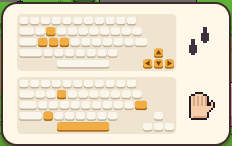

**한국어** · [日本語](../../ja/controls/kb.md) · [中文](../../zh/controls/kb.md) · [English](../../en/controls/kb.md)

[동방일일담](../../../README.md) › [조작법](../controls.md) › **키보드** &nbsp;1 / 6

#  키보드

| | |
|---|---|
| <kbd>W</kbd> <kbd>A</kbd> <kbd>S</kbd> <kbd>D</kbd> / <kbd>↑</kbd> <kbd>←</kbd> <kbd>↓</kbd> <kbd>→</kbd> | 걷기 |
| <kbd>Space</kbd> / <kbd>E</kbd> / <kbd>Z</kbd> / <kbd>Enter</kbd> | 행동: 앞에 있는 것에 쓰기 · 말 걸기 · 줍기 · 문 열기 |
| <kbd>1</kbd> – <kbd>8</kbd> | 핫바 칸 고르기 (든 도구·물건) |
| <kbd>Q</kbd> / <kbd>R</kbd> | 핫바 이전 칸 / 다음 칸 |
| <kbd>I</kbd> / <kbd>Tab</kbd> / <kbd>X</kbd> | 가방 열기 |
| <kbd>V</kbd> | 빈손으로 바꾸기 / 되돌리기 |
| <kbd>G</kbd> | 들고 있는 것을 앞 칸에 내려놓기 |
| <kbd>C</kbd> | 그 자리에 앉기 / 일어나기 |
| <kbd>M</kbd> | 세계 지도 |
| <kbd>Esc</kbd> | 메뉴 · 창 닫기 |

> 게임 첫날 화면에도 같은 내용이 키보드 그림으로 나옵니다.

---

[목록](../controls.md) &nbsp;·&nbsp; [마우스 →](mouse.md)
