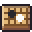

**한국어** · [日本語](../../ja/controls/menu.md) · [中文](../../zh/controls/menu.md) · [English](../../en/controls/menu.md)

[동방일일담](../../../README.md) › [조작법](../controls.md) › **메뉴** &nbsp;5 / 6

#  메뉴

메뉴 (Esc · 톱니 단추)

| | |
|---|---|
|  | 지금 저장 |
|  | 전체 화면 |
|  | 방 사진 저장 (PNG) |
|  | 내 모습 사진 저장 (PNG) |
|  | 그래픽 품질 |
|  | 취했을 때 화면 흔들림 켜기/끄기 |
|  | 보드게임 배우기 |
|  | 저장하고 타이틀로 |
|  | 저장 파일 내보내기 |
|  | 저장 파일 가져오기 |
|  | 만든 사람들 |
|  | 소리 크기 (음악 · 효과음) |

---

[← 화면 단추](hud.md) &nbsp;·&nbsp; [목록](../controls.md) &nbsp;·&nbsp; [알아 두면 좋은 것 →](tips.md)
