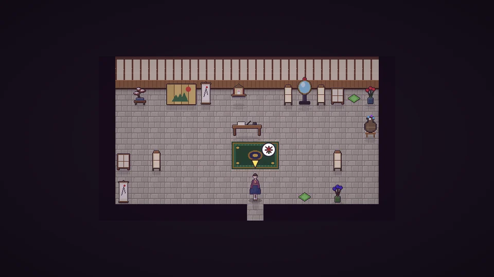

[한국어](../../ko/content/chaos.md) · [日本語](../../ja/content/chaos.md) · **中文** · [English](../../en/content/chaos.md)

[동방일일담](../../../README.zh.md) › [游戏内容](../content.md) › **破坏与代价** &nbsp;10 / 12

#  破坏与代价

可以用锤子破坏物品或建筑。破坏自己的东西会返还材料，但破坏别人的东西会被人看见或听见，流言扩散，幻想乡也会变得混乱。

修好被破坏的东西或做好事，可以慢慢恢复。夜晚去拜访阎魔四季映姬接受审判，镜子会映出你的所作所为;完成赎罪后，剩下的也能被洗清。

---

[← 祭典](fest.md) &nbsp;·&nbsp; [目录](../content.md) &nbsp;·&nbsp; [模拟模式 →](sim.md)
