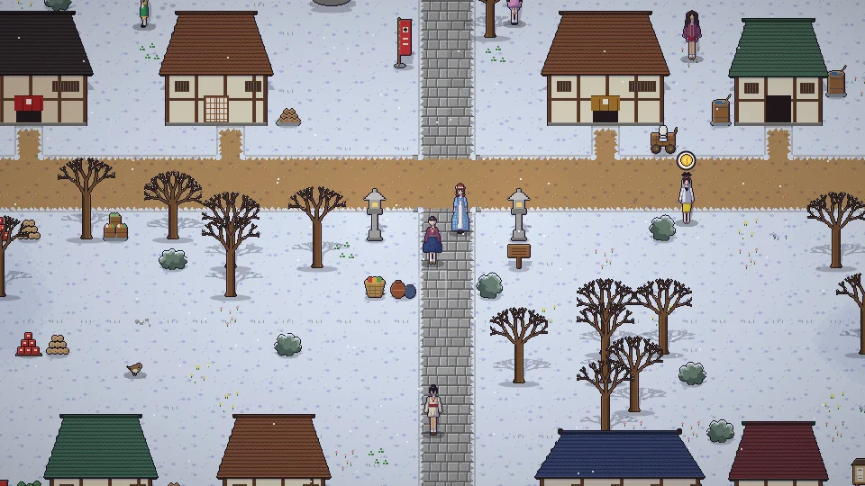

[한국어](../../ko/content/day.md) · [日本語](../../ja/content/day.md) · **中文** · [English](../../en/content/day.md)

[동방일일담](../../../README.zh.md) › [游戏内容](../content.md) › **一天与四季** &nbsp;2 / 12

#  一天与四季

时间不断流逝。春・夏・秋・冬各28天，作物、鱼、可采集的东西以及人们的日程都会随季节和天气而变化。

劳动会消耗体力。在床上睡觉就会到第二天早晨并恢复体力。过度劳累会晕倒，请注意。

---

[← 开始游戏](start.md) &nbsp;·&nbsp; [目录](../content.md) &nbsp;·&nbsp; [种田・采集・钓鱼 →](farm.md)
