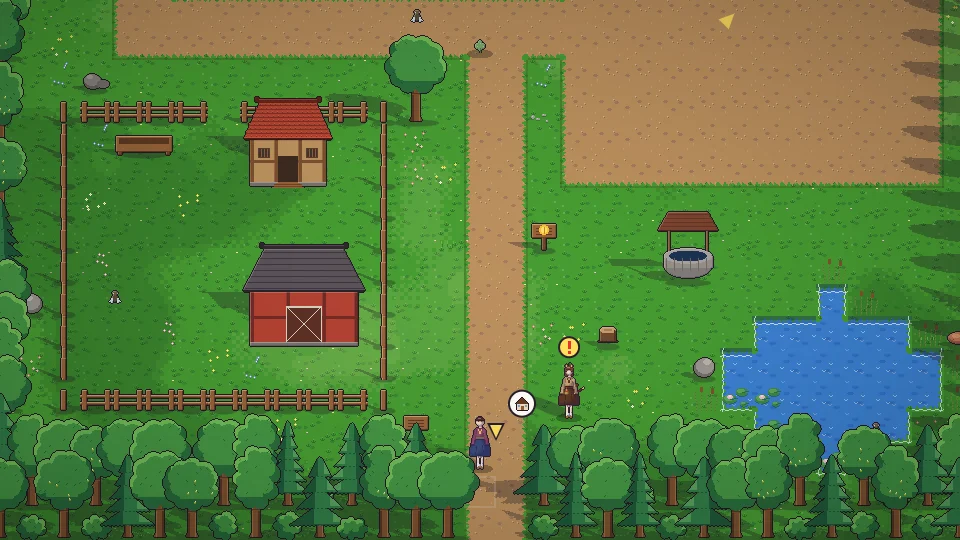

[한국어](../../ko/content/farm.md) · [日本語](../../ja/content/farm.md) · **中文** · [English](../../en/content/farm.md)

[동방일일담](../../../README.zh.md) › [游戏内容](../content.md) › **种田・采集・钓鱼** &nbsp;3 / 12

#  种田・采集・钓鱼

- 用锄头翻地、播种，再用水壶浇水。照料得越用心，收获的品质(★)越高。
- 用斧头获取木材，用镐获取石头和矿石。矿山每一层的地形都会重新变化。
- 手持钓竿在水边行动即可开始钓鱼。鱼咬钩后稍等片刻再拉上来。
- 用捕虫网抓虫子，在野外拾取草和果实，照顾动物。

---

[← 一天与四季](day.md) &nbsp;·&nbsp; [目录](../content.md) &nbsp;·&nbsp; [加工・制作・研究 →](craft.md)
