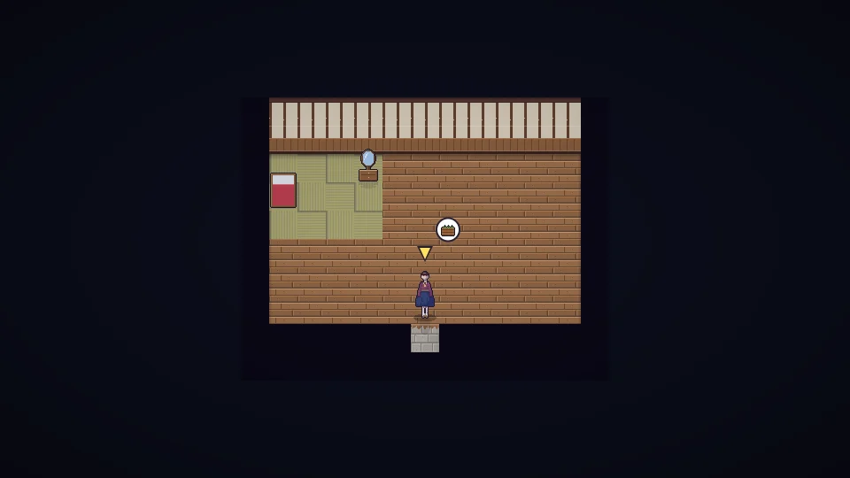

[한국어](../../ko/content/home.md) · [日本語](../../ja/content/home.md) · **中文** · [English](../../en/content/home.md)

[동방일일담](../../../README.zh.md) › [游戏内容](../content.md) › **房屋・装饰・服装** &nbsp;7 / 12

#  房屋・装饰・服装

- 摆放家具和装饰来布置房屋。越舒适，房屋星级(★)越高，体力上限增加，也会有客人来访。
- 可以通过研究扩建房屋。
- 可以更换服装和发型。衣服穿久了会变旧。
- 角・翅膀・耳朵・尾巴等特殊装饰无法在一开始选择，只能通过与居民的羁绊或祭典获得。

---

[← 工作与金钱](work.md) &nbsp;·&nbsp; [目录](../content.md) &nbsp;·&nbsp; [世界 →](world.md)
