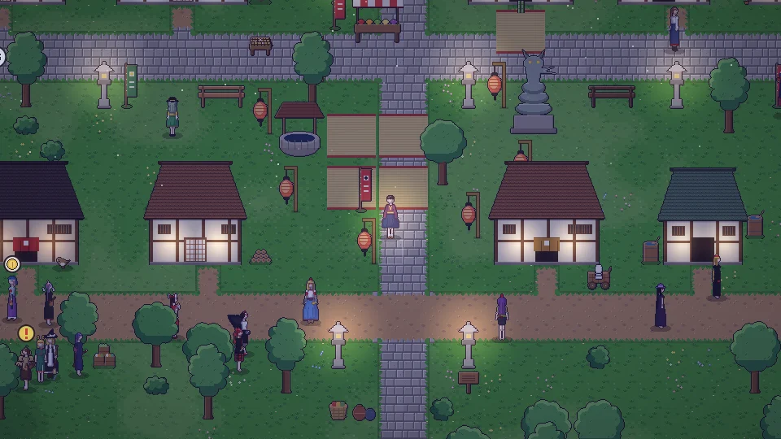

[한국어](../../ko/content/sim.md) · [日本語](../../ja/content/sim.md) · **中文** · [English](../../en/content/sim.md)

[동방일일담](../../../README.zh.md) › [游戏内容](../content.md) › **模拟模式** &nbsp;11 / 12

#  模拟模式

按下右上角最后一个按钮，你的角色就会自己过日子。角色会按照隐藏的性格行动，性格也会随所做的事慢慢变化。随时再按一次即可回到手动操作。

---

[← 破坏与代价](chaos.md) &nbsp;·&nbsp; [目录](../content.md) &nbsp;·&nbsp; [存档与照片 →](save.md)
