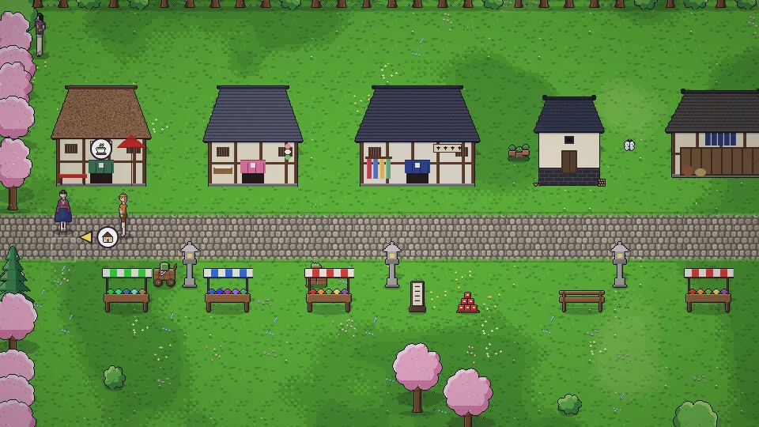

[한국어](../../ko/content/work.md) · [日本語](../../ja/content/work.md) · **中文** · [English](../../en/content/work.md)

[동방일일담](../../../README.zh.md) › [游戏内容](../content.md) › **工作与金钱** &nbsp;6 / 12

#  工作与金钱

- 与雇主交谈即可打工(每天一次)。以简短的小游戏进行，结果用★和硬币表示。
- 制作或收获的东西可以卖给商店。
- 拥有自己的店铺后，可以定价、雇用店员做生意。季节需求和口碑会影响营业额。
- 与契约商人立约后，对方会从家里的交货箱取走商品并留下货款。

---

[← 人物](people.md) &nbsp;·&nbsp; [目录](../content.md) &nbsp;·&nbsp; [房屋・装饰・服装 →](home.md)
