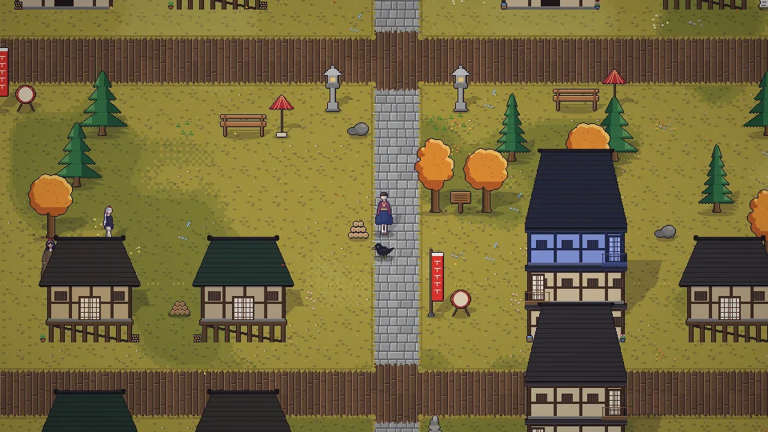

[한국어](../../ko/content/world.md) · [日本語](../../ja/content/world.md) · **中文** · [English](../../en/content/world.md)

[동방일일담](../../../README.zh.md) › [游戏内容](../content.md) › **世界** &nbsp;8 / 12

#  世界

可以步行往来于人类村落、博丽神社、雾之湖、红魔馆、魔法森林、迷途竹林与永远亭、妖怪之山与守矢神社、命莲寺、玄武之泽等地。天空(冥界・天界)和地下(旧都・地灵殿等)是不同的层。

可以从地图边缘的出口步行前往，也可以在世界地图(M)中点击已知的地点移动。用地图移动会根据距离消耗时间和体力。

有些地方需要和当地居民关系变好，或与其同行才能进入。在竹林中很容易迷路。

---

[← 房屋・装饰・服装](home.md) &nbsp;·&nbsp; [目录](../content.md) &nbsp;·&nbsp; [祭典 →](fest.md)
