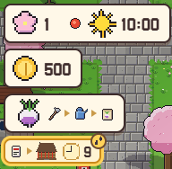
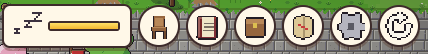
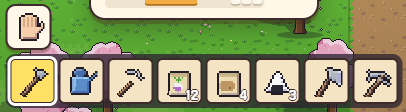

[한국어](../../ko/controls/hud.md) · [日本語](../../ja/controls/hud.md) · **中文** · [English](../../en/controls/hud.md)

[동방일일담](../../../README.zh.md) › [操作说明](../controls.md) › **画面按钮** &nbsp;4 / 6

#  画面按钮

### 左上

1. 季节・日期・天气・时间
2. 持有金钱
3. 现在可以尝试的事(图卡)
4. 约定・待办事项与剩余时间

### 右上

1. 体力条 — 劳动会减少，睡觉会恢复
2. 坐下(椅子・地面)
3. 研究
4. 背包
5. 世界地图
6. 菜单
7. 模拟模式 开/关

### 下方

1. 空手按钮
2. 快捷栏8格 — 选中的格子就是手中的东西，数字是剩余数量

---

[← 触屏](touch.md) &nbsp;·&nbsp; [目录](../controls.md) &nbsp;·&nbsp; [菜单 →](menu.md)
