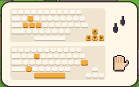

[한국어](../../ko/controls/kb.md) · [日本語](../../ja/controls/kb.md) · **中文** · [English](../../en/controls/kb.md)

[동방일일담](../../../README.zh.md) › [操作说明](../controls.md) › **键盘** &nbsp;1 / 6

#  键盘

| | |
|---|---|
| <kbd>W</kbd> <kbd>A</kbd> <kbd>S</kbd> <kbd>D</kbd> / <kbd>↑</kbd> <kbd>←</kbd> <kbd>↓</kbd> <kbd>→</kbd> | 行走 |
| <kbd>Space</kbd> / <kbd>E</kbd> / <kbd>Z</kbd> / <kbd>Enter</kbd> | 行动：使用面前的东西・交谈・拾取・开门 |
| <kbd>1</kbd> – <kbd>8</kbd> | 选择快捷栏格子(手持的工具・物品) |
| <kbd>Q</kbd> / <kbd>R</kbd> | 快捷栏上一格/下一格 |
| <kbd>I</kbd> / <kbd>Tab</kbd> / <kbd>X</kbd> | 打开背包 |
| <kbd>V</kbd> | 切换为空手/切换回来 |
| <kbd>G</kbd> | 把手中的东西放到前方格子 |
| <kbd>C</kbd> | 原地坐下/站起 |
| <kbd>M</kbd> | 世界地图 |
| <kbd>Esc</kbd> | 菜单・关闭窗口 |

> 游戏第一天的画面上也会用键盘图示显示同样的内容。

---

[目录](../controls.md) &nbsp;·&nbsp; [鼠标 →](mouse.md)
