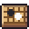

[한국어](../../ko/controls/menu.md) · [日本語](../../ja/controls/menu.md) · **中文** · [English](../../en/controls/menu.md)

[동방일일담](../../../README.zh.md) › [操作说明](../controls.md) › **菜单** &nbsp;5 / 6

#  菜单

菜单(Esc・齿轮按钮)

| | |
|---|---|
|  | 立即存档 |
|  | 全屏 |
|  | 保存房间照片(PNG) |
|  | 保存自己的形象照片(PNG) |
|  | 画质 |
|  | 醉酒时画面摇晃 开/关 |
|  | 学习棋类游戏 |
|  | 存档并回到标题 |
|  | 导出存档文件 |
|  | 导入存档文件 |
|  | 制作人员 |
|  | 音量(音乐・音效) |

---

[← 画面按钮](hud.md) &nbsp;·&nbsp; [目录](../controls.md) &nbsp;·&nbsp; [小提示 →](tips.md)
